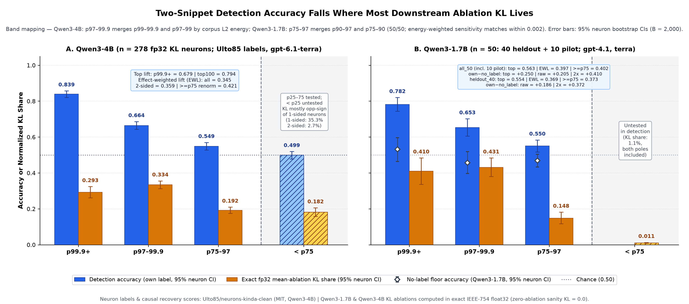
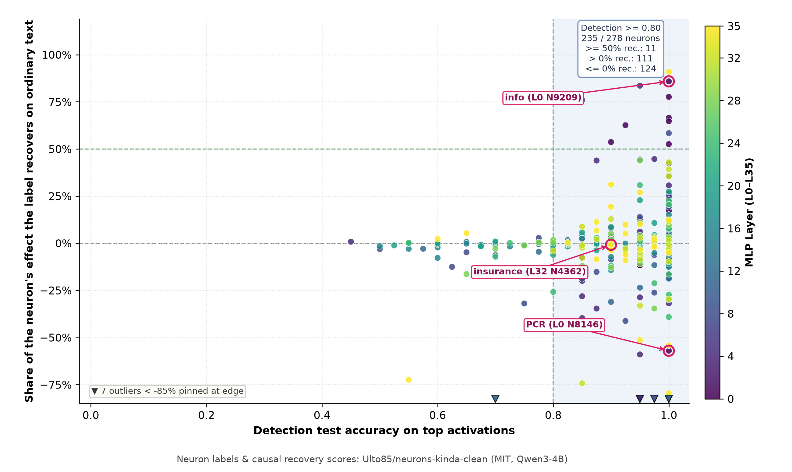

# How much of a neuron does a detection score cover?

On Qwen3-4B and Qwen3-1.7B, neuron labels score 0.78 to 0.84 on Goodfire's detection test for the strongest activations, which carry 29 to 41% of the neuron's downstream effect; below them accuracy falls toward chance.

## Summary

In Goodfire's detection test, a judge reads a neuron label and two snippets and picks where the neuron fires. Goodfire reports accuracy between 0.91 and 0.97 on a large mixture-of-experts model. I ran the same test across activation bands on two small dense models: Qwen3-4B with Ulto85's published labels and Qwen3-1.7B with labels I generated with gpt-4.1. I added blank-label and wrong-label floors on Qwen3-1.7B and measured each band's share of downstream effect. On Qwen3-4B, accuracy is 0.84 on top activations and falls to 0.66, 0.55 and 0.50 in the bands below, while that top band holds 29% of the effect. Weighted by downstream effect, lift over chance falls from 0.68 to 0.35 on Qwen3-4B, and from 0.56 to 0.40 on Qwen3-1.7B. Nearly a third of Qwen3-4B neurons score perfectly on detection, yet their causal recovery (Ulto85's scores) spans strongly negative values up to 0.91. Because labels, judge, and models differ, Goodfire's figure does not carry over here, though this does not show it is wrong.

## Takeaways

- A high detection score on top activations says little about most of what a neuron does.
- Passing detection does not tell you the label can stand in for the neuron, while failing it is a bad sign: none of the 43 failing neurons reach 0.25 causal recovery, against about one in ten overall.
- On Qwen3-1.7B, a bare token list scores within 0.03 of the label, and twenty examples beat the label, 0.88 against 0.78.
- What I could not show: the weak-band detection test is partly unanswerable by design, the Qwen3-1.7B causal check was inconclusive, and the Qwen3-4B audit was exploratory.

## What I saw reading the poles

When I read Ulto85's info example (layer 0, neuron 9209, perfect detection and high recovery), the label described the standalone word for information and related prefixes. Its top snippets hit "info" and "INFO", alongside weaker top hits on "infinity", "informant", and "_STATS", and the judge got all five right. In the weaker band, I saw unrelated words like "to", "for", "investors", and "about" that the label never mentions.

I saw a sharper split on Ulto85's PCR example (layer 0, neuron 8146, perfect detection and negative recovery), whose label predicts uppercase acronyms, especially those starting with P or C. All five top snippets hit uppercase acronyms ("PCs", "PC", "GDPR", and "GP"), and the judge got every pair right. In the weaker band, the marked tokens were plain words ("incredible", "steel", "helped", "of", and "hunter") that the label misses, and the judge got three of five wrong.

On a neuron that fails detection (layer 16, neuron 2492), the label describes technical terms being introduced or defined. Even in the top band, I saw only one clear fit ("Fossil" in a passage on fossil fuels), while the other four fired on "IV", "Communities", "scar", and a typo fragment. In the weaker band, the marked tokens were ordinary words like "play", "know", and "some" in unrelated prose, and the judge missed four of five.

## Glossary

- **`pole`**: One signed activation direction (`pos` `a > 0`, or `neg` `a < 0`) of a neuron; **`one-sided`** (unipolar, `n = 132` on `4B`) has 1 active pole, while **`two-sided`** (bipolar, `n = 146`) has both active.
- **`own` vs `no_label`**: Binary judge prompted with the pole's explanation (`own`) vs. `"(none provided)"` (`no_label`).
- **`sim_cal_rec`**: Fraction of mean-ablation KL divergence avoided (`1 - KL(clean || sim_cal) / KL(clean || mean_ablate)`) when replacing true neuron activations with calibrated simulator predictions (`2`-fold CV on `1.7B`).
- **`sim_cal_rec_active`**: Same calibrated recovery restricted to tokens where `|a| >= 20% max` (plus neighborhood).
- **`strong20_rec`**: Oracle fraction of mean-ablation KL recovered when setting weak activations (`|a| < 20% max`) to zero and keeping strong activations exact.
- **`KLShare(B)`**: Fraction of total exact IEEE-754 `float32` mean-ablation KL divergence from activation band `B`.
- **`EnergyShare(B)`**: Fraction of centered corpus activation variance $\sum_{t \in B} (a_t - \bar{a})^2 / \sum_t (a_t - \bar{a})^2$ in band `B` (second-order sanity check against `KLShare`).
- **`EWL`**: Effect-Weighted Detection Lift $\sum_b \text{KLShare}(b)\cdot 2(\text{acc}(b)-0.5) \in [-1, +1]$ (`0` = chance weighted by KL).
- **`top100`**: Top-100 highest-activation snippets per pole on `1.536M` disjoint FineWeb tokens (post hoc after `295/424` active poles had `p99.9 < 0.20 * max`).
- **`dead_zone` vs `goodfire_lt_p90` & `Q1`–`Q4`**: `dead_zone` requires distractor target `|a| < P25(|a|)` and whole 69-tok window `< p90` (`goodfire_lt_p90` omits `|a| < P25`); SwiGLU gate open `g > 0` (`Q1`/`Q2`) vs. gate closed `g < 0` (`Q3`/`Q4`).

## Effect-Weighted Detection Lift Across Bands

`KLShare` weights each band by exact IEEE-754 `float32` mean-ablation KL (`0.0` zero-ablation sanity KL): relative to `p99.9+` lift, `Qwen3-4B` EWL drops roughly in half (`0.679 -> 0.345`, ratio `0.51`), while `Qwen3-1.7B` retains more (`all_50`, incl. `10` pilot neurons / `20` poles: `0.563 -> 0.397`, ratio `0.71`; `heldout_40`: `0.554 -> 0.369`, ratio `0.67`). Across `4B` (`n = 278`), `p97–99.9` merge sensitivity spans `0.327–0.345` (token-width `0.9/2.0`: `0.327`, equal `50/50`: `0.336`, corpus L2 energy: `0.345`), and per-neuron EWL has median `0.35` (`0.348`, IQR `[0.104, 0.574]`) with `15.1%` (`42/278`) negative.

| Model / Cohort | n | `p99.9+` Acc | `p97–99.9` Acc | `p75–97` Acc | `p25–75` tested | `KL < p99.9+` | EWL (all bands) [95% CI] | EWL (`>= p75` renorm) |
|---|---:|---:|---:|---:|---:|---:|---:|---:|
| `Qwen3-4B` (all scored) | 278 | 0.839 | 0.664 | 0.549 | 0.499 | 70.7% | **0.345** [0.309, 0.382] | 0.421 [0.384, 0.458] |
| `Qwen3-4B` (two-sided) | 146 | 0.807 | 0.639 | 0.528 | 0.517 | 68.4% | **0.359** [0.314, 0.407] | 0.364 [0.320, 0.410] |
| `Qwen3-1.7B` (`all_50`, incl. `10` pilot) | 50 | 0.782 | 0.653 | 0.550 | — | 59.0% | **0.397** [0.330, 0.470] | 0.402 [0.332, 0.470] |
| `Qwen3-1.7B` (`heldout_40`, `own`) | 40 | 0.777 | 0.623 | 0.547 | — | 57.8% | **0.369** [0.297, 0.439] | 0.373 [0.301, 0.445] |
| `Qwen3-1.7B` (`all_50`, `own - no_label`) | 50 | +0.250 | +0.197 | +0.082 | — | 59.0% | **+0.410** [+0.290, +0.539] (+0.205 raw) | +0.414 (+0.207 raw) |
| `Qwen3-1.7B` (`heldout_40`, `own - no_label`) | 40 | +0.242 | +0.165 | +0.066 | — | 57.8% | **+0.372** [+0.240, +0.504] (+0.186 raw) | +0.376 (+0.188 raw) |

## Top-Band Detection vs. Full-Distribution Causal Recovery (`Qwen/Qwen3-4B`, `n = 278`)

Across `278` scored `Qwen/Qwen3-4B` neurons (`gpt-6.1-terra@none`), `0 of 43` failing neurons (`top100 < 0.80`) reach `sim_cal_rec >= 0.25`, against `27 of 278` overall (`267/278 < 0.50`, `251/278 < 0.25`). Likewise `1 of 43` failing neurons reaches `sim_cal_rec_active >= 0.50`, against `63 of 235` passing (`top100 >= 0.80`), yet `224 of 235` passing stay below `sim_cal_rec < 0.50`, and `top100` does not rank causal recovery (`ρ = 0.142`, spanning `[-7.110, +0.909]` at `top100 == 1.00`, `n = 86`).

## Comparison Against Goodfire Table 4 (Random-Text Controls)

| Benchmark | Model & Routing | Explainer / Judge | Poles (Neurons) | `p97–99` | `p99–99.9` | `p99.9+` | `top100` / `top1000` |
|---|---|---|---|---:|---:|---:|---:|
| Goodfire Table 4 | `Qwen3.6-35B-A3B` (MoE, routed) | Goodfire modes / `Opus 5.5` (10/call) | 496 | 0.906 | 0.932 | `0.952 (p99.9–99.99) / 0.972 (p99.99+)` | 0.970 (`top1000`) |
| `Qwen3-4B` (neuron means) | `Qwen/Qwen3-4B` (dense) | Ulto85 Claude / `gpt-6.1-terra@none` (1/call) | 424 (278) | 0.613 | 0.686 | 0.839 | 0.897 (`top100`) |
| `Qwen3-1.7B` (`heldout_80`, per-neuron) | `Qwen/Qwen3-1.7B` (dense) | `gpt-4.1` / `gpt-6.1-terra@none` (1/call) | 80 (40) | 0.594 | 0.659 | 0.777 | — |

*Caption: Goodfire evaluates routed MoE activations (`a * w_router`) using Goodfire Neuron Scientist mode descriptions, `Opus 5.5` in 10-pair batches, and random-text distractors; these evaluations use dense SwiGLU activations, Ulto85 Claude (`4B`: `0.828`/`0.888` per-pole vs. `0.839`/`0.897` per-neuron) or `gpt-4.1` (`1.7B`: `0.679` per-pole vs. `0.659` per-neuron at `p99–99.9`) labels, `gpt-6.1-terra@none` at 1 pair per call, and `dead_zone` distractors.*

## Related Work

- **Nick Cammarata**, [*Neural Networks Are Already Clean*](https://already-clean.goodfire.com/) (essay); **Curt Tigges, Matthew Kowal, Thomas McGrath, Owen Lewis, & Nick Cammarata**, [*Neurons as an Interpretable Basis*](https://www.goodfire.com/research/neurons-as-an-interpretable-basis) (paper): introduced the multi-band marked-token detection and weak-band ablation protocol on `Qwen3.6-35B-A3B`.
- **Leo Gao**, [*Neural networks are not already clean*](https://www.lesswrong.com/posts/Dkh7pXKjoNWkkxQDz/neural-networks-are-not-already-clean): argues clean top examples do not show a neuron is understood, and that weak activations probably cannot be ignored.
- **Aayan Rizvi**, [`Ulto85/neurons-kinda-clean`](https://github.com/Ulto85/neurons-kinda-clean) (commit `85c71b7`, MIT): showed Claude labels often fail full-distribution causal substitution, a clean rating is necessary but not sufficient, and introduced the `info`, `PCR`, and `insurance` examples.
- **Stepan Shabalin & Mateusz Piotrowski**, *Comparing Sparsified MLPs and Transcoders: Many Transcoder Features Are Neurons in Disguise* (`arXiv:2610.24521`, 2026): found that transcoder features aligned with single MLP neurons are the ones with a stable link to the MLP, so neurons may be a stronger basis than assumed.
- **What is new here:** I measure marked-token two-snippet 2AFC detection across activation bands and weight detection lift by mean-ablation KL divergence and causal recovery across dense `Qwen3-4B` and `Qwen3-1.7B`.

## Part 1 Held-Out Predictions

Part 1 predictions were written before the held-out `Qwen3-1.7B` run on the same day, not independently timestamped; three missed (`wrong` `p75–90` accuracy `0.515 > 0.50`, `p90–97` marginal gate-open lift `+0.029 < +0.08`, and `nearest_wgate_tier0` matched difference `-0.013` vs `<= -0.02`). Everything else in this repository is exploratory.

## Limitations & Disclosures

- **Ulto85 scope & labels:** `278` of `280` neurons in `e3_neurons.json` are scored in `e3_scores.json` (`(12, 1597)` and `(24, 289)` unscored), and `132` weak/negligible poles were excluded (`424` active poles kept); Ulto85 labels and scores were written by Claude models (Opus explainer, Sonnet/Opus simulator).
- **`< p90` distractor strength overlap:** Distractor windows only have to stay below `p90`, so for `p25–75` and part of `p75–97` positives the distractor can contain an unmarked token stronger than the marked positive token; near-chance accuracy there is partly by design (`473/600` [`78.8%`] overall and `378/480` [`78.8%`] on `heldout_80` in `1.7B` `p75–90` `dead_zone`, vs. `0/600` in `p90–97`, `p97–99.9`, `p99.9+`; `4B` snippet files are not shipped).
- **Inconclusive `Qwen3-1.7B` causal re-run:** Using single-pass `gpt-4.1` labels (`mean FPR_ord = 0.141`) and a sparse JSON `gpt-6.1-terra@none` simulator (`median corr = 0.079`), oracle `strong20_rec >= 0.25` holds in `34/50` (`28/50` on the 8k slice) while calibrated simulator recovery reaches `>= 0.25` in `0/50` (`sim_cal_rec_active >= 0.50` in `0/50`), so `1.7B` causal simulation is inconclusive ([exploratory appendix](docs/exploratory_appendix.md)).
- **`top100` post hoc & lexical overlap:** Added post hoc; `30.6%` (`2,591/8,480`) exact word / `37.9%` (`3,210/8,480`) CI substring target-token overlap with Ulto85 labels (computed from the `top100` snippet file `snippets_4b_top100.jsonl`, which is not shipped). Unipolar (`n = 132`) `< p75` KL (`0.353`) reflects opposite-sign energy (`0.351`) vs. two-sided (`0.027` / `0.000`).
- **Position bias, logprob imputation & KL sanity check:** Judges show mild Slot B preference (`P(pred=A) = 0.454` `p99.9+`, `0.474` `top100`, `0.415` `no_label`, `0.407` `wrong`, `0.411` `p97–99`, at `P(pos=A) = 0.500`); in exploratory YES/NO probes, `96.4%` (`4,086/4,240`) `terra` / `89.2%` (`7,566/8,480`) `luna` ordinary `YES` logprobs were floor-imputed, and `FPR_ord` missed `sim < 0` (`PCR = 0.000`). Pooled `EvalEnergy` vs `KLShare` is a second-order sanity check (`4B`: `ρ = 0.861`, clustered `[0.830, 0.887]`, pair `[0.838, 0.882]`, null `[0.045, 0.172]`; `1.7B`: `ρ = 0.907`, clustered `[0.855, 0.942]`, pair `[0.863, 0.936]`, null `[0.561, 0.706]`).

## Credits & Data Licenses

- Code & evaluations: MIT ([`LICENSE`](LICENSE)). Third-party `Qwen3-4B` neuron explanations & causal scores: [`Ulto85/neurons-kinda-clean`](https://github.com/Ulto85/neurons-kinda-clean) (commit `85c71b7`, MIT, [`data/qwen4b/ulto85/LICENSE`](data/qwen4b/ulto85/LICENSE)).
- **ODC-By data note:** Corpus snippets in `data/` come from `HuggingFaceFW/fineweb-edu` (`Qwen3-1.7B`) and `HuggingFaceFW/fineweb` (`Qwen3-4B`) under **ODC-By**, not MIT.

## Documentation & Offline Reproduction

- [`docs/methods.md`](docs/methods.md) · [`docs/detailed_tables.md`](docs/detailed_tables.md) · [`docs/exploratory_appendix.md`](docs/exploratory_appendix.md) · [`docs/decisions.md`](docs/decisions.md) · [`audit/reading_sheet_12_neurons.md`](audit/reading_sheet_12_neurons.md)
- Execute [`notebooks/regenerate_figures.ipynb`](notebooks/regenerate_figures.ipynb) offline (regenerates `results/qwen4b/effect_weighted.json` & all 11 PNGs) and run CPU tests: `CUDA_VISIBLE_DEVICES="" OPENAI_API_KEY="" PYTHONPATH="src" pytest -W error::RuntimeWarning -v`
